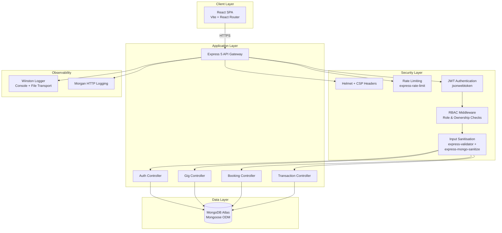

# HustleHub+ — Secure Freelance Marketplace

A full-stack freelance marketplace platform built with the MERN stack, emphasising security best practices, role-based access control, and industry-standard authentication patterns. Part 2 extends the foundational work of Part 1 by introducing a fully functional frontend, comprehensive booking and transaction systems, and end-to-end API testing.

---

## Team Members

| Student Number | Name             | Role                            |
| -------------- | ---------------- | ------------------------------- |
| ST10058999     | Lesego Masike    | Backend Development, Security   |
| ST10456656     | Senamiso Ndlovu  | Frontend Development, Testing   |
| ST10454205     | Sameer Singh     | Documentation, Integration      |

---

## Project Overview

HustleHub+ is a secure freelance marketplace that connects clients who need digital services with freelancers who offer them. The platform facilitates the full lifecycle of freelance work: freelancers list their gigs, clients browse and book services, and the system records transactions with built-in income tracking and tax estimation.

**Key objectives:**

- Implement a production-grade RESTful API following the architectural constraints defined by Fielding (2000)
- Apply defence-in-depth security across every layer of the stack, aligned with the OWASP Top 10 (2021)
- Enforce strict role-based access control separating client, freelancer, and admin capabilities
- Provide a responsive React frontend with secure client-side routing and state management
- Deliver comprehensive API test coverage through automated Postman/Newman test suites

---

## System Architecture



The architecture follows a layered approach where every incoming request passes through multiple security gates before reaching the business logic. This defence-in-depth strategy ensures that no single point of failure can compromise the application (OWASP, 2021).

---

## Features

### Authentication and Authorisation
- User registration with email uniqueness enforcement
- Secure login with JWT-based stateless authentication (Jones, Bradley and Sakimura, 2015)
- Password hashing using bcrypt with 12 salt rounds (Provos and Mazieres, 1999)
- Protected profile endpoint with automatic password field exclusion

### Role-Based Access Control
- Three distinct user roles: **client**, **freelancer**, and **admin**
- Middleware-enforced role restrictions on all protected endpoints
- Ownership verification preventing cross-user resource modification (OWASP, 2023d)

### Gig Management
- Full CRUD operations for freelancer service listings
- Category-based classification (web development, mobile, design, writing, marketing, data science)
- Price and delivery time management
- Personal listing dashboard for freelancers

### Booking System
- Clients can book available gigs from freelancers
- Booking status tracking throughout the service lifecycle
- Separate booking views for clients and freelancers

### Transaction and Income Tracking
- Automatic transaction recording upon booking creation
- Freelancer income summary with aggregated totals
- South African tax estimation at 25% (SARS, 2024)
- Net income calculation after estimated tax deduction

### Security Features
- Helmet security headers with Content Security Policy (Mozilla, 2024)
- Rate limiting on authentication and booking endpoints
- MongoDB query sanitisation preventing NoSQL injection attacks
- Input validation using express-validator
- HTTPS enforcement with TLS certificates (Rescorla, 2018)
- Safe error handling that prevents internal detail leakage

---

## Security Decisions

Each security measure was selected based on industry standards, academic research, and the OWASP guidelines. The following subsections document the rationale for each decision.

### 1. Password Hashing with bcrypt (12 Salt Rounds)

**Why:** Storing passwords in plaintext or with reversible encryption is identified as a critical vulnerability in the OWASP Top 10 under A02:2021 — Cryptographic Failures (OWASP, 2021). The bcrypt algorithm was chosen because it is an adaptive hashing function specifically designed for password storage, incorporating a per-hash salt and a configurable work factor that increases computational cost over time (Provos and Mazieres, 1999).

A cost factor of 12 was selected following the OWASP Password Storage Cheat Sheet recommendation, which balances security against server response time. At this setting, each hash operation takes approximately 250 milliseconds, making brute-force attacks computationally infeasible while maintaining acceptable login latency (OWASP, 2023b). The NIST Digital Identity Guidelines further reinforce the use of memory-hard or computationally expensive hashing algorithms for credential storage (NIST, 2017).

### 2. JWT for Stateless Authentication

**Why:** JSON Web Tokens provide a stateless authentication mechanism that eliminates server-side session storage, improving horizontal scalability in distributed environments (Jones, Bradley and Sakimura, 2015). Each token is cryptographically signed using HMAC-SHA256, ensuring that tampered tokens are rejected during verification.

The token includes the user ID and role in its payload, enabling the server to authenticate and authorise requests without database lookups on every request. Tokens are issued with a configurable expiration time, limiting the window of exposure if a token is compromised. This approach aligns with the REST architectural style's statelessness constraint (Fielding, 2000) and the OWASP Authentication Cheat Sheet's recommendations for token-based authentication in single-page applications (OWASP, 2023a).

### 3. HTTPS with TLS Certificates

**Why:** Transport Layer Security encrypts all data in transit between the client and server, preventing eavesdropping, man-in-the-middle attacks, and credential interception (Rescorla, 2018). Without TLS, JWT tokens transmitted over HTTP are vulnerable to interception, rendering the entire authentication system ineffective.

The application uses self-signed TLS certificates for development and is configured for production deployment with certificates from a trusted Certificate Authority. This satisfies the OWASP REST Security Cheat Sheet's requirement that all API communication occur exclusively over encrypted channels (OWASP, 2023c).

### 4. Input Validation with express-validator

**Why:** The OWASP Input Validation Cheat Sheet identifies insufficient input validation as a root cause of injection attacks, cross-site scripting, and business logic bypasses (OWASP, 2023e). The express-validator library provides a declarative validation pipeline that runs before request handlers, ensuring that malformed or malicious input is rejected at the API boundary.

Validation rules enforce constraints such as minimum and maximum string lengths, email format verification, password complexity requirements, and enumerated value checks for fields like user roles and gig categories. This server-side validation operates independently of any client-side checks, following the principle that all client input must be treated as untrusted (OWASP, 2021).

### 5. MongoDB Sanitisation (NoSQL Injection Prevention)

**Why:** NoSQL injection attacks exploit the ability to pass operator expressions (such as `$gt`, `$ne`, or `$regex`) in request parameters to manipulate database queries (OWASP, 2021). The `express-mongo-sanitize` middleware strips these operators from user input before it reaches the Mongoose query layer, neutralising injection attempts at the middleware level.

This defence is particularly important for authentication endpoints where an attacker might attempt to bypass password checks by injecting query operators into the login payload. Combined with Mongoose's schema-based type casting, this provides layered protection against data-layer attacks (MongoDB, 2024).

### 6. Rate Limiting on Auth and Booking Endpoints

**Why:** Rate limiting mitigates brute-force attacks against authentication endpoints and prevents abuse of resource-intensive operations such as booking creation. The `express-rate-limit` middleware enforces a configurable request threshold per IP address within a sliding time window.

Authentication endpoints receive stricter limits (e.g., 10 requests per 15 minutes) because they are the primary target for credential-stuffing attacks. Booking endpoints are rate-limited to prevent automated reservation abuse. When a client exceeds the threshold, the server responds with HTTP 429 (Too Many Requests), following the REST convention for signalling throttled access (OWASP, 2023c).

### 7. Helmet Security Headers with Content Security Policy

**Why:** HTTP security headers instruct the browser to enable built-in protections against common web vulnerabilities. Helmet sets multiple headers in a single middleware call, including `X-Content-Type-Options`, `X-Frame-Options`, `Strict-Transport-Security`, and `X-XSS-Protection` (Mozilla, 2024).

The Content Security Policy (CSP) header is configured to restrict the sources from which the browser can load scripts, styles, images, and other resources. This mitigates cross-site scripting (XSS) attacks by preventing the execution of inline scripts and blocking resources from unauthorised origins. The CSP directives follow the principle of least privilege, allowing only the specific sources required by the application (Mozilla, 2024).

### 8. Role-Based Access Control with Ownership Checks

**Why:** RBAC restricts API operations based on the authenticated user's assigned role, enforcing the principle of least privilege at the application layer (OWASP, 2023d). In HustleHub+, freelancers can create, update, and delete their own gigs but cannot book services; clients can browse gigs and create bookings but cannot modify gig listings.

Beyond role checks, ownership verification ensures that a freelancer can only modify or delete gigs they created, preventing horizontal privilege escalation. This two-layer authorisation model — role-based plus resource-ownership-based — is recommended by the OWASP Access Control Cheat Sheet as the minimum standard for multi-tenant applications (OWASP, 2023d).

### 9. Safe Error Handling (No Internal Details Leaked)

**Why:** Detailed error messages containing stack traces, database query information, or internal file paths provide attackers with reconnaissance data that can be used to craft targeted exploits (OWASP, 2021). The application uses a centralised error-handling utility that returns generic, user-friendly error messages to the client while logging full diagnostic details to the server-side log files via Winston.

In production mode, the `NODE_ENV` variable suppresses detailed error output. All API responses follow a consistent `{ success, message, data }` structure, ensuring that error responses never inadvertently expose internal implementation details (Express.js, 2024).

---

## API Endpoints

| Method | Endpoint                      | Auth Required | Role Required | Description                              |
| ------ | ----------------------------- | ------------- | ------------- | ---------------------------------------- |
| POST   | `/api/auth/register`          | No            | —             | Register a new user account              |
| POST   | `/api/auth/login`             | No            | —             | Authenticate and receive a JWT token     |
| GET    | `/api/auth/profile`           | Yes           | Any           | Retrieve the authenticated user's profile|
| GET    | `/api/gigs`                   | Yes           | Any           | List all available gigs                  |
| GET    | `/api/gigs/:id`               | Yes           | Any           | Get a specific gig by ID                 |
| POST   | `/api/gigs`                   | Yes           | Freelancer    | Create a new gig listing                 |
| PUT    | `/api/gigs/:id`               | Yes           | Freelancer    | Update an owned gig                      |
| DELETE | `/api/gigs/:id`               | Yes           | Freelancer    | Delete an owned gig                      |
| GET    | `/api/gigs/my/listings`       | Yes           | Freelancer    | List gigs created by the freelancer      |
| POST   | `/api/bookings`               | Yes           | Client        | Book a gig                               |
| GET    | `/api/bookings`               | Yes           | Any           | List bookings (filtered by role)         |
| GET    | `/api/bookings/:id`           | Yes           | Any           | Get a specific booking by ID             |
| GET    | `/api/transactions`           | Yes           | Any           | List transactions (filtered by role)     |
| GET    | `/api/transactions/income`    | Yes           | Freelancer    | Get income summary with tax estimation   |

---

## Tech Stack

### Backend

| Technology            | Version  | Purpose                                    |
| --------------------- | -------- | ------------------------------------------ |
| Node.js               | 20.x LTS| JavaScript runtime environment             |
| Express               | 5.2.1    | Web application framework                  |
| MongoDB               | 7.x     | NoSQL document database                    |
| Mongoose              | 8.14.3   | MongoDB object data modelling (ODM)        |
| bcryptjs              | 3.0.3    | Password hashing with adaptive cost factor |
| jsonwebtoken          | 9.0.3    | JWT creation and verification              |
| express-validator     | 7.3.2    | Request validation middleware              |
| express-mongo-sanitize| 2.2.0    | NoSQL injection prevention                 |
| express-rate-limit    | 7.5.0    | Request rate limiting                      |
| helmet                | 8.3.0    | Security HTTP headers                      |
| cors                  | 2.8.6    | Cross-origin resource sharing              |
| morgan                | 1.10.0   | HTTP request logging                       |
| winston               | 3.17.0   | Application-level logging                  |
| dotenv                | 17.4.2   | Environment variable management            |
| nodemon               | 3.1.14   | Development auto-restart (dev dependency)  |
| newman                | 6.2.1    | Postman collection CLI runner (dev dependency) |

### Frontend

| Technology                  | Version | Purpose                              |
| --------------------------- | ------- | ------------------------------------ |
| React                       | 18.3.1  | User interface library               |
| React DOM                   | 18.3.1  | DOM rendering for React              |
| React Router DOM            | 6.28.0  | Client-side routing                  |
| Axios                       | 1.7.9   | HTTP client for API requests         |
| Vite                        | 6.0.0   | Frontend build tool and dev server   |
| @vitejs/plugin-react        | 4.3.4   | React support for Vite               |
| Vitest                      | 2.1.0   | Unit testing framework               |
| @testing-library/react      | 16.1.0  | React component testing utilities    |
| @testing-library/jest-dom   | 6.6.3   | Custom DOM matchers for testing      |
| @testing-library/user-event | 14.5.2  | User interaction simulation          |
| jsdom                       | 25.0.0  | DOM implementation for testing       |

---

## Project Structure

```
HustleHub-Part2/
├── .env                              # Environment variables (gitignored)
├── .env.example                      # Environment template
├── .eslintrc.json                    # Backend ESLint configuration
├── .gitignore                        # Git ignore rules
├── .dockerignore                     # Backend Docker build exclusions
├── Dockerfile                        # Backend Docker container
├── docker-compose.yml                # Multi-container orchestration
├── package.json                      # Backend dependencies and scripts
├── server.js                         # HTTPS server entry point
├── generate-certs.js                 # TLS certificate generator
├── HustleHub+.postman_collection.json        # Postman test collection
├── HustleHub+_Environment.postman_environment.json  # Postman environment
├── README.md                         # Project documentation
├── logs/                             # Application logs (gitignored)
├── .github/
│   └── workflows/
│       └── ci.yml                    # GitHub Actions CI/CD pipeline
├── src/
│   ├── app.js                        # Express application setup
│   ├── config/
│   │   ├── index.js                  # Centralised configuration
│   │   └── db.js                     # MongoDB connection with retry
│   ├── controllers/
│   │   ├── authController.js         # Authentication logic
│   │   ├── gigController.js          # Gig CRUD operations
│   │   ├── bookingController.js      # Booking management
│   │   └── transactionController.js  # Transaction and income logic
│   ├── middleware/
│   │   ├── auth.js                   # JWT verification and RBAC middleware
│   │   ├── rateLimiter.js            # Rate limiting configuration
│   │   ├── sanitise.js               # NoSQL injection prevention
│   │   ├── securityFeatures.js       # Request ID tracking and account lockout
│   │   ├── validate.js               # Input validation rules
│   │   └── errorHandler.js           # Centralised error handling
│   ├── models/
│   │   ├── User.js                   # User schema with bcrypt hooks
│   │   ├── Gig.js                    # Gig schema with categories
│   │   ├── Booking.js                # Booking schema
│   │   └── Transaction.js            # Transaction schema
│   ├── routes/
│   │   ├── authRoutes.js             # /api/auth endpoints
│   │   ├── gigRoutes.js              # /api/gigs endpoints
│   │   ├── bookingRoutes.js          # /api/bookings endpoints
│   │   └── transactionRoutes.js      # /api/transactions endpoints
│   └── utils/
│       ├── logger.js                 # Winston logger configuration
│       └── response.js               # Standardised response helpers
└── client/
    ├── .dockerignore                 # Frontend Docker build exclusions
    ├── .eslintrc.json                # Frontend ESLint configuration
    ├── Dockerfile                    # Frontend Docker container (multi-stage)
    ├── nginx.conf                    # Nginx reverse proxy configuration
    ├── index.html                    # HTML entry point
    ├── package.json                  # Frontend dependencies
    ├── vite.config.js                # Vite configuration with API proxy
    └── src/
        ├── main.jsx                  # React entry point
        ├── App.jsx                   # Root component with routing
        ├── App.css                   # Application styles
        ├── index.css                 # Global styles
        ├── api/
        │   └── axios.js              # Axios instance with JWT interceptor
        ├── components/
        │   ├── Navbar.jsx            # Role-based navigation bar
        │   └── PrivateRoute.jsx      # Authentication route guard
        ├── context/
        │   └── AuthContext.jsx       # Authentication state provider
        ├── pages/
        │   ├── Login.jsx             # Login page
        │   ├── Register.jsx          # Registration page
        │   ├── Dashboard.jsx         # User dashboard
        │   ├── BrowseGigs.jsx        # Gig browsing page
        │   ├── CreateGig.jsx         # Gig creation form
        │   ├── EditGig.jsx           # Gig editing form
        │   ├── MyGigs.jsx            # Freelancer gig management
        │   ├── Bookings.jsx          # Booking management
        │   ├── Transactions.jsx      # Transaction history
        │   └── IncomeDashboard.jsx   # Income summary with tax estimation
        └── __tests__/
            ├── App.test.jsx          # App component tests
            └── Login.test.jsx        # Login component tests
```

---

## Setup Instructions

### Prerequisites

- **Node.js** v20.x or later — [https://nodejs.org/](https://nodejs.org/)
- **MongoDB** v7.x (local installation or MongoDB Atlas cloud cluster)
- **Git** — [https://git-scm.com/](https://git-scm.com/)
- **OpenSSL** (for generating TLS certificates)

### Step 1: Clone the Repository

```bash
git clone https://github.com/your-repo/HustleHub-Part2.git
cd HustleHub-Part2
```

### Step 2: Install Backend Dependencies

```bash
npm install
```

### Step 3: Install Frontend Dependencies

```bash
cd client
npm install
cd ..
```

### Step 4: Set Up MongoDB

**Option A — MongoDB Atlas (Recommended):**
1. Create a free cluster at [https://cloud.mongodb.com/](https://cloud.mongodb.com/)
2. Create a database user with read/write permissions
3. Whitelist your IP address under Network Access
4. Copy the connection string

**Option B — Local MongoDB:**
1. Install MongoDB Community Edition
2. Start the MongoDB service: `mongod`
3. Use the connection string: `mongodb://localhost:27017/hustlehub`

### Step 5: Configure Environment Variables

Copy the example environment file and populate it:

```bash
cp .env.example .env
```

Edit `.env` with your values:

```env
PORT=5000
MONGO_URI=mongodb+srv://<username>:<password>@cluster.mongodb.net/hustlehub
JWT_SECRET=your_secure_random_secret_key_here
JWT_EXPIRES_IN=1h
NODE_ENV=development
```

> **Security note:** Generate a cryptographically strong JWT secret using `node -e "console.log(require('crypto').randomBytes(64).toString('hex'))"`. Never commit the `.env` file to version control.

### Step 6: Generate SSL/TLS Certificates

```bash
npm run generate-certs
```

Alternatively, generate self-signed certificates manually with OpenSSL:

```bash
mkdir -p certs
openssl req -x509 -newkey rsa:4096 -keyout certs/key.pem -out certs/cert.pem -days 365 -nodes -subj "/CN=localhost"
```

### Step 7: Start the Backend Server

```bash
# Development mode (with auto-restart)
npm run dev

# Production mode
npm start
```

The API server starts on `https://localhost:5000`.

### Step 8: Start the Frontend Development Server

In a separate terminal:

```bash
cd client
npm run dev
```

The React application starts on `http://localhost:5173` with API requests proxied to the backend.

### Step 9: Access the Application

- **Frontend:** Open `http://localhost:5173` in your browser
- **API:** Send requests to `https://localhost:5000/api`
- **Note:** Accept the self-signed certificate warning in development

---

## Testing

### Postman Collection

A comprehensive Postman test collection is included with 26 requests across 5 folders:

| Folder       | Requests | Coverage                                           |
| ------------ | -------- | -------------------------------------------------- |
| Auth         | 8        | Registration, login, profile, negative cases        |
| Gigs         | 8        | CRUD operations, role restrictions                  |
| Bookings     | 6        | Booking creation, retrieval, role restrictions       |
| Transactions | 4        | Transaction listing, income summary, role checks    |
| Security     | 3        | Missing token, invalid token, rate limiting          |

**Import into Postman:**

1. Open Postman and click **Import**
2. Select `HustleHub+.postman_collection.json`
3. Import `HustleHub+_Environment.postman_environment.json`
4. Select the **HustleHub+ Environment** from the environment dropdown
5. Run the collection sequentially (Auth folder first to populate tokens)

### Newman (CLI Execution)

Run the full test suite from the command line:

```bash
npx newman run HustleHub+.postman_collection.json \
  -e HustleHub+_Environment.postman_environment.json \
  --reporters cli,json \
  --reporter-json-export results.json
```

### Frontend Tests

```bash
cd client
npm test
```

Frontend tests use Vitest with React Testing Library for component-level unit and integration testing.

---

## User Roles

### Client

Clients are individuals or organisations seeking freelance services. They can:

- Register an account and authenticate
- Browse all available gig listings
- View detailed information about specific gigs
- Book gigs offered by freelancers
- View their booking history
- View their transaction history

Clients **cannot** create, update, or delete gig listings, nor can they access freelancer income summaries.

### Freelancer

Freelancers are service providers who list their skills on the platform. They can:

- Register an account and authenticate
- Create gig listings with title, description, category, price, and delivery time
- Update and delete their own gig listings
- View a dashboard of their active listings
- View bookings placed on their gigs
- View their transaction history
- Access their income summary with tax estimation

Freelancers **cannot** book gigs or access client-specific functionality.

### Admin

Administrators have elevated privileges for platform management. They can:

- Access all endpoints available to clients and freelancers
- View and manage all users, gigs, bookings, and transactions
- Perform administrative actions such as account suspension

> **Note:** Admin functionality is reserved for platform operations and is not exposed through the standard user registration flow.

---

## Income and Tax Calculation

The income summary endpoint (`GET /api/transactions/income`) provides freelancers with a financial overview of their earnings. The calculation follows this logic:

1. **Total Income:** The sum of all completed transaction amounts where the freelancer is the service provider.

2. **Estimated Tax (25%):** A simplified tax estimation based on the South African individual income tax rates. The 25% rate represents a conservative middle-bracket estimate for freelance income, acknowledging that actual tax liability depends on the individual's total taxable income and applicable rebates (SARS, 2024).

3. **Net Income:** The total income minus the estimated tax deduction.

**Example calculation:**

| Metric          | Value     |
| --------------- | --------- |
| Total Income    | R 13 000  |
| Estimated Tax   | R 3 250   |
| Net Income      | R 9 750   |

> **Disclaimer:** The tax estimation is provided for informational purposes only and does not constitute tax advice. Freelancers should consult a registered tax practitioner for accurate tax calculations based on their individual circumstances.

---

## Docker Containerisation

The application is fully containerised using Docker, enabling consistent deployment across environments and simplifying the setup process.

### Backend Dockerfile

The backend container uses a **Node.js 20 Alpine** base image for a minimal footprint. Key security measures include:
- A non-root user (`appuser`) runs the application inside the container, following the OWASP Docker Security Cheat Sheet recommendation (OWASP, 2023c)
- A built-in health check endpoint (`/api/health`) allows Docker to monitor container health and automatically restart unhealthy instances
- Only production dependencies are installed (`npm ci --only=production`), reducing attack surface
- Development files such as `.env.example` and `generate-certs.js` are removed from the production image

### Frontend Dockerfile

The frontend uses a **multi-stage build** to separate the build environment from the production serving environment:
1. **Build stage:** Uses Node.js 20 Alpine to install dependencies and run `npm run build`, producing optimised static assets via Vite
2. **Production stage:** Uses the lightweight `nginx:alpine` image to serve the compiled React SPA, resulting in a final image that contains only the static files and the nginx web server

### Docker Compose Orchestration

The `docker-compose.yml` file defines three services:

| Service    | Image/Build     | Port  | Purpose                                |
| ---------- | --------------- | ----- | -------------------------------------- |
| `mongodb`  | `mongo:7`       | 27017 | NoSQL database with health check       |
| `backend`  | Custom Dockerfile | 5000  | Express API server                     |
| `frontend` | Custom Dockerfile | 80    | nginx serving the React SPA            |

All services communicate over a private Docker bridge network (`hustlehub-network`). The backend waits for MongoDB to be healthy before starting, ensuring database availability.

### Running with Docker

```bash
# Build and start all containers
docker-compose up --build

# Run in detached mode
docker-compose up --build -d

# Stop all containers
docker-compose down

# Stop and remove volumes (clears database)
docker-compose down -v
```

Once running, access the application at `http://localhost` (frontend) or `http://localhost:5000/api` (backend API).

---

## CI/CD Pipeline

A GitHub Actions workflow (`.github/workflows/ci.yml`) automates testing, analysis, and building on every push and pull request to the `main` branch.

### Pipeline Jobs

The pipeline consists of four jobs:

| Job               | Purpose                                           | Dependencies         |
| ----------------- | ------------------------------------------------- | -------------------- |
| `backend-tests`   | Starts a MongoDB service container, launches the Express server, and runs Newman API tests against the live server | None |
| `frontend-tests`  | Installs frontend dependencies, runs Vitest unit tests, and builds the production bundle | None |
| `static-analysis` | Runs ESLint on both backend and frontend code, and executes `npm audit` for dependency vulnerability scanning | None |
| `build`           | Builds both Docker images to verify containerisation works | `backend-tests`, `frontend-tests` |

### Pipeline Behaviour

- **Parallel execution:** `backend-tests`, `frontend-tests`, and `static-analysis` run concurrently to minimise total pipeline time
- **Gated build:** The Docker image build job only runs after both test suites pass, preventing broken images from being built
- **Artifact uploads:** Newman test results and static analysis reports are uploaded as pipeline artifacts for review, even if the job fails
- **Dependency caching:** npm dependencies are cached between runs using the `actions/setup-node` cache feature, reducing installation time

---

## Static Code Analysis

### ESLint Configuration

ESLint is configured for both the backend and frontend with project-specific rulesets:

**Backend (`.eslintrc.json`):**
- Environment: Node.js with CommonJS modules
- Key rules: `eqeqeq` (strict equality), `no-eval` and `no-implied-eval` (prevent code injection), `no-new-func` (block dynamic function creation)
- Unused variable warnings ignore common Express parameters (`req`, `res`, `next`, `err`)

**Frontend (`client/.eslintrc.json`):**
- Environment: Browser with ES modules
- Extends: `eslint:recommended`, `plugin:react/recommended`, `plugin:react-hooks/recommended`
- React-specific: automatic JSX runtime (no need to import React), prop-types disabled in favour of runtime validation

### npm Audit

The `npm audit` command is executed during the CI pipeline to identify known vulnerabilities in project dependencies. Results are exported as a JSON artifact for review.

### Running Locally

```bash
# Backend linting
npm run lint

# Frontend linting
cd client
npm run lint

# Dependency vulnerability check
npm audit
```

---

## Logging

The application uses **Winston** for structured server-side logging, capturing events critical to security monitoring, debugging, and compliance.

### What Is Logged

| Event Category         | Examples                                      | Purpose                                  |
| ---------------------- | --------------------------------------------- | ---------------------------------------- |
| Login attempts         | Successful logins, failed password attempts, non-existent email attempts | Detect brute-force and credential stuffing attacks |
| User registration      | New account creation with email and role       | Audit trail for account management       |
| Booking creation       | New bookings with client and gig details       | Financial audit trail                    |
| Transaction recording  | Transaction amounts and involved parties       | Regulatory compliance                    |
| Application errors     | Unhandled exceptions, database errors          | Debugging and incident response          |
| HTTP requests          | Method, URL, status code, response time (via Morgan) | Traffic analysis and performance monitoring |
| Account lockout events | IP-based lockout triggers and blocked attempts | Security incident detection              |

### Log Configuration

- **Format:** Each log entry includes a timestamp, severity level, and descriptive message (e.g., `2026-09-25 14:30:00 [info]: User logged in: user@example.com`)
- **Transports:** Console output (for development) and file output (`logs/app.log`) for persistent storage
- **HTTP logging:** Morgan is configured with the `combined` format and pipes output through Winston for unified log management
- **Storage:** Log files are stored in the `logs/` directory, which is excluded from version control via `.gitignore`

---

## Additional Security Features

Beyond the baseline security measures implemented in Part 2, two additional security features have been added to strengthen the application's defences:

### 1. Request ID Tracking

Every incoming HTTP request is assigned a unique identifier (UUID v4) via the `requestIdMiddleware`. This ID is:
- Attached to the response as the `X-Request-ID` header, allowing clients to reference specific requests in support queries
- Stored on the `req.requestId` property for use in server-side log entries
- Propagated from upstream services if an `X-Request-ID` header is already present in the incoming request

This enables **distributed tracing** and **log correlation** across services, which is essential for debugging production issues and conducting incident response in microservice architectures (OWASP, 2023f).

### 2. Account Lockout

The `loginAttemptTracker` middleware implements IP-based account lockout to prevent brute-force and credential stuffing attacks:

| Parameter         | Value      | Rationale                                          |
| ----------------- | ---------- | -------------------------------------------------- |
| Max attempts      | 5          | OWASP-recommended threshold before lockout         |
| Tracking window   | 15 minutes | Balances security with legitimate user convenience  |
| Lockout duration  | 15 minutes | Sufficient to deter automated attacks              |

**How it works:**
1. Each failed login attempt increments a counter for the requesting IP address
2. After 5 consecutive failures within 15 minutes, the IP is temporarily blocked
3. Blocked requests receive HTTP 429 with a message indicating how long to wait
4. A successful login clears the failure counter for that IP
5. Expired records are automatically cleaned up every 30 minutes to prevent memory leaks

This defence operates in addition to the existing `express-rate-limit` middleware, providing a layered approach: rate limiting throttles overall request volume, while account lockout specifically targets repeated authentication failures (OWASP, 2023a).

---

## Final Security Review

The following table maps each OWASP Top 10 (2021) threat category to the specific protections implemented in HustleHub+:

| OWASP Threat                       | Protection Implemented                                                                                     |
| ---------------------------------- | ---------------------------------------------------------------------------------------------------------- |
| A01: Broken Access Control         | RBAC middleware enforces role-based restrictions; ownership checks prevent cross-user resource modification  |
| A02: Cryptographic Failures        | bcrypt password hashing with 12 salt rounds; JWT signed with HS256; HTTPS with TLS encryption              |
| A03: Injection                     | express-validator input validation; express-mongo-sanitize strips NoSQL operators; parameterised Mongoose queries |
| A04: Insecure Design               | Defence-in-depth with multiple security layers; principle of least privilege applied to roles and routes    |
| A05: Security Misconfiguration     | Helmet security headers with explicit CSP; safe error handling hides internals; secrets in `.env` files    |
| A06: Vulnerable Components         | npm audit integrated into CI pipeline; dependency version pinning in package-lock.json                     |
| A07: Authentication Failures       | Account lockout after 5 failed attempts; rate limiting on auth endpoints; generic error messages prevent user enumeration |
| A08: Data Integrity Failures       | JWT signature verification on every protected request; input validation on all user-supplied data          |
| A09: Logging and Monitoring Failures | Winston logging of auth events, transactions, errors, and lockouts; Morgan HTTP request logging           |
| A10: Server-Side Request Forgery   | No external URL fetching implemented; API-only backend with no outbound HTTP requests                      |

---

## References

Fielding, R. (2000) *Architectural Styles and the Design of Network-Based Software Architectures*. PhD thesis. University of California, Irvine.

Express.js (2024) 'Express 5.x API Reference'. Available at: https://expressjs.com/en/5x/api.html (Accessed: 18 September 2026).

Jones, M., Bradley, J. and Sakimura, N. (2015) 'JSON Web Token (JWT)', *RFC 7519*, Internet Engineering Task Force. Available at: https://datatracker.ietf.org/doc/html/rfc7519 (Accessed: 12 September 2026).

MongoDB (2024) 'Mongoose ODM Documentation'. Available at: https://mongoosejs.com/docs/guide.html (Accessed: 18 September 2026).

Mozilla (2024) 'Content Security Policy (CSP)', *MDN Web Docs*. Available at: https://developer.mozilla.org/en-US/docs/Web/HTTP/CSP (Accessed: 15 September 2026).

NIST (2017) 'Digital Identity Guidelines: Authentication and Lifecycle Management', *Special Publication 800-63B*. Available at: https://pages.nist.gov/800-63-3/sp800-63b.html (Accessed: 14 September 2026).

OWASP (2021) 'OWASP Top 10 — 2021'. Available at: https://owasp.org/Top10/ (Accessed: 10 September 2026).

OWASP (2023a) 'Authentication Cheat Sheet', *OWASP Cheat Sheet Series*. Available at: https://cheatsheetseries.owasp.org/cheatsheets/Authentication_Cheat_Sheet.html (Accessed: 15 September 2026).

OWASP (2023b) 'Password Storage Cheat Sheet', *OWASP Cheat Sheet Series*. Available at: https://cheatsheetseries.owasp.org/cheatsheets/Password_Storage_Cheat_Sheet.html (Accessed: 15 September 2026).

OWASP (2023c) 'REST Security Cheat Sheet', *OWASP Cheat Sheet Series*. Available at: https://cheatsheetseries.owasp.org/cheatsheets/REST_Security_Cheat_Sheet.html (Accessed: 15 September 2026).

OWASP (2023d) 'Access Control Cheat Sheet', *OWASP Cheat Sheet Series*. Available at: https://cheatsheetseries.owasp.org/cheatsheets/Access_Control_Cheat_Sheet.html (Accessed: 15 September 2026).

OWASP (2023e) 'Input Validation Cheat Sheet', *OWASP Cheat Sheet Series*. Available at: https://cheatsheetseries.owasp.org/cheatsheets/Input_Validation_Cheat_Sheet.html (Accessed: 15 September 2026).

Provos, N. and Mazieres, D. (1999) 'A Future-Adaptable Password Scheme', *Proceedings of the 1999 USENIX Annual Technical Conference*. Available at: https://www.usenix.org/legacy/events/usenix99/provos/provos.pdf (Accessed: 12 September 2026).

React (2024) 'React Documentation'. Available at: https://react.dev/ (Accessed: 18 September 2026).

Rescorla, E. (2018) 'The Transport Layer Security (TLS) Protocol Version 1.3', *RFC 8446*, Internet Engineering Task Force. Available at: https://datatracker.ietf.org/doc/html/rfc8446 (Accessed: 14 September 2026).

Docker (2024) 'Dockerfile Reference'. Available at: https://docs.docker.com/reference/dockerfile/ (Accessed: 22 September 2026).

ESLint (2024) 'Getting Started with ESLint'. Available at: https://eslint.org/docs/latest/use/getting-started (Accessed: 22 September 2026).

GitHub (2024) 'GitHub Actions Documentation'. Available at: https://docs.github.com/en/actions (Accessed: 22 September 2026).

OWASP (2023f) 'Logging Cheat Sheet', *OWASP Cheat Sheet Series*. Available at: https://cheatsheetseries.owasp.org/cheatsheets/Logging_Cheat_Sheet.html (Accessed: 22 September 2026).

South African Revenue Service (2024) 'Tax rates for individuals'. Available at: https://www.sars.gov.za/tax-rates/income-tax/rates-of-tax-for-individuals/ (Accessed: 20 September 2026).

Winston (2024) 'winston Logger Documentation'. Available at: https://www.npmjs.com/package/winston (Accessed: 22 September 2026).
